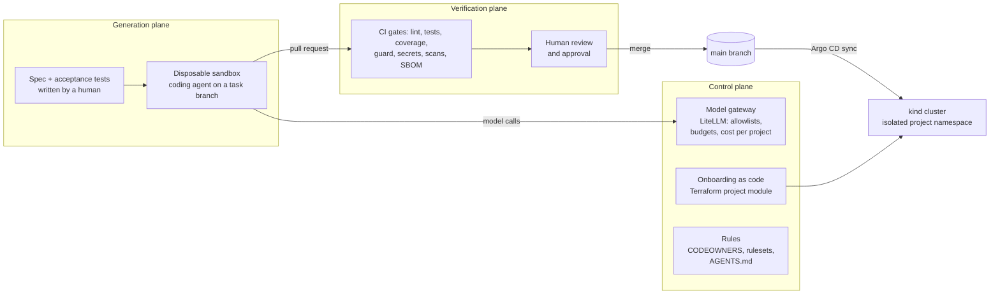

# Mini AI Software Factory

A small, working version of an AI-native software factory, built to learn by doing.
AI agents implement features from specs inside a disposable sandbox, call models only
through a governed gateway, and everything they produce must pass a verification pipeline
they cannot change, followed by a human approval, before GitOps deploys it to Kubernetes.

The product it builds is deliberately boring (a Notes API), so the attention goes to the
factory around it.

## The three planes



| Plane | What it does here | Where |
|---|---|---|
| Generation | A coding agent works in a throwaway container with only its own scoped credentials: a GitHub token for a separate agent account, and a gateway key for one project. | `sandbox/` |
| Verification | Independent gates the agent cannot modify: lint, unit and acceptance tests, coverage threshold, a guard that detects weakened tests, spec traceability, secret scanning, dependency, misconfiguration and image scanning, an SBOM and an evidence record. Then a human approves. | `.github/`, `scripts/guard_tests.py`, `tests/acceptance/` |
| Control | Model access, budgets and cost per project; onboarding a project as code; the rules and context that steer agents. | `gateway/`, `terraform/`, `AGENTS.md`, `.github/CODEOWNERS` |

## Repository map

| Path | Purpose |
|---|---|
| `app/` | The Notes API (FastAPI) |
| `specs/` | One spec per feature; `Status: pending` or `implemented` |
| `tests/unit/` | Unit tests (agents add to these) |
| `tests/acceptance/` | Human-owned acceptance tests, tied to each spec's status |
| `scripts/guard_tests.py` | Fails pull requests that delete, skip or weaken tests, or touch protected paths |
| `.github/workflows/verify.yml` | The verification pipeline, with every action pinned to a commit SHA |
| `AGENTS.md`, `CLAUDE.md`, `.claude/` | Agent context and client-side guardrails |
| `gateway/` | LiteLLM model gateway: hosted and local models, per-project keys and data classes, guardrails, cost report, kill switch |
| `rag/` | Retrieval with document-level permissions, answering through the gateway |
| `governance/` | Evidence pack for a merged pull request |
| `sandbox/` | Disposable agent container |
| `terraform/` | Reusable "project" module (namespace, quotas, network policies, identity, access), two onboarded projects and an isolation test |
| `deploy/` | Kubernetes manifests and the Argo CD application |
| `docs/GUIDE.md` | Step-by-step build guide, in phases |

## Start here

Follow [`docs/GUIDE.md`](docs/GUIDE.md) phase by phase. Quick local check:

```bash
python3 -m venv .venv && . .venv/bin/activate
pip install -r requirements-dev.txt
pytest            # 20 passed, 16 xfailed: spec 001 is pending, waiting for your agent
ruff check . && ruff format --check .
```

## What has been verified, and what has not

Verified before handing this over: the test suite and linter; the spec-status mechanism
(with a throwaway reference implementation of spec 001); the guard against deleted tests,
added skips, removed assertions, a lowered coverage threshold and unapproved edits to
protected paths; Kubernetes manifests against the official schemas (kubeconform);
Terraform formatting; the workflow syntax (actionlint); Trivy misconfiguration scanning
(zero findings at medium and above); Gitleaks (no findings, and it catches a planted fake
token).

Not yet run anywhere: the Docker image build, the kind cluster, Argo CD, the gateway, the
sandbox and the real GitHub Actions run. You will be the first to run them, so expect to
debug a thing or two; that is part of the learning.
