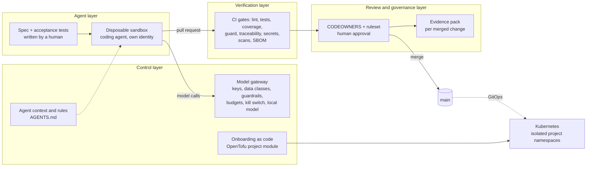

# Mini AI Software Factory

A small, working version of an AI-native software factory, built to learn by doing.
AI agents implement features from specs inside a disposable sandbox, call models only
through a governed gateway, and everything they produce must pass a verification pipeline
they cannot change, followed by an accountable human approval.

The product it builds is deliberately boring (a Notes API), so the attention goes to the
factory around it.

## The four layers



| Layer | What it does here | Where |
|---|---|---|
| Agent | A coding agent works on one task in a throwaway, hardened container, with only its own scoped credentials: a GitHub token for a separate machine account and a gateway key for one project. Specs and acceptance tests, written by humans, define "done". | `sandbox/`, `specs/`, `tests/acceptance/` |
| Control | Every model call goes through the gateway: per-project virtual keys, model allowlists by data class (confidential projects only reach a local model), input guardrails that block secrets and mask personal data, budgets, cost reports and a kill switch. Projects are onboarded as code with tested isolation. The agent's rules and context live in `AGENTS.md`. | `gateway/`, `terraform/`, `AGENTS.md` |
| Verification | Independent gates the agent cannot modify: lint, unit and acceptance tests, a coverage threshold, a guard that detects weakened tests and protected-path changes, spec traceability, secret scanning, dependency, misconfiguration and image scanning, an SBOM. | `.github/workflows/`, `scripts/guard_tests.py` |
| Review and governance | CODEOWNERS and a ruleset make a named human approve every change; protected paths need an explicit label. An evidence pack records, per merged change, the spec, who wrote it (human or agent), who approved which commit, the gates and a re-run of the guard. | `.github/CODEOWNERS`, `governance/` |

The repository also contains a small RAG component with document-level permissions
(`rag/`), as a second example of governed AI use.

## Repository map

| Path | Purpose |
|---|---|
| `app/` | The Notes API (FastAPI) |
| `specs/` | One spec per feature; `Status: pending` or `implemented` |
| `tests/unit/` | Unit tests (agents add to these) |
| `tests/acceptance/` | Human-owned acceptance tests, tied to each spec's status |
| `scripts/guard_tests.py` | Fails pull requests that delete, skip or weaken tests, or touch protected paths |
| `.github/workflows/verify.yml` | The verification pipeline, with every action pinned to a commit SHA |
| `AGENTS.md`, `CLAUDE.md`, `.claude/` | Agent context and client-side guardrails |
| `gateway/` | LiteLLM model gateway: hosted and local models, per-project keys and data classes, guardrails, cost report, kill switch |
| `rag/` | Retrieval with document-level permissions, answering through the gateway |
| `governance/` | Evidence pack for a merged pull request |
| `sandbox/` | Disposable agent container |
| `terraform/` | Reusable "project" module (namespace, quotas, network policies, identity, access), two onboarded projects and an isolation test |
| `deploy/` | Kubernetes manifests and the Argo CD application |
| `docs/GUIDE.md` | Step-by-step build guide, in phases |

## Start here

Follow [`docs/GUIDE.md`](docs/GUIDE.md) phase by phase. Quick local check:

```bash
python3 -m venv .venv && . .venv/bin/activate
pip install -r requirements-dev.txt
pytest            # all tests pass; a pending spec's acceptance tests show as xfailed
ruff check . && ruff format --check .
```

## What has been run, and what has not

Run end to end on a laptop: the GitHub Actions pipeline on every pull request; the gateway
(LiteLLM with Postgres) with hosted and local models; the agent sandbox, which implemented
spec 001 and fixed an issue through pull requests; the guardrails; a kind cluster with two
projects onboarded through OpenTofu and an isolation test; the RAG permission tests; the
evidence pack.

Not yet run: the Argo CD deployment of the Notes API, and an observability stack.

## What I found

- Spec 001 cost $0.155 in six model calls, first-time green on every gate. Input tokens
  were 98% of the volume; prompt caching cut the cost by about 60%.
- A budget is a soft cap: the request that crosses it is still served.
- The agent ignored a prompt injection hidden in an issue and reported it; the
  traceability gate then caught a gap in the agent's instructions, not in the model.
- Regex guardrails stop accidents, not adversaries: a spaced IBAN, a paraphrased email and
  a base64 token all passed. Confidential data is protected by routing, not by redaction.
- In RAG, filtering permissions after ranking leaks nothing directly but starves users of
  results and reveals that hidden documents exist.
- The evidence pack showed that an admin bypass meant for the owner's own pull requests had
  also been used to merge an agent's pull request without approval.

## How this was built

Designed, run and debugged as a personal learning project in October 2026. Much of the
code was written with an AI coding assistant, and features in `app/` were implemented by
the sandboxed agent itself through reviewed pull requests, which is the point of the
exercise.
